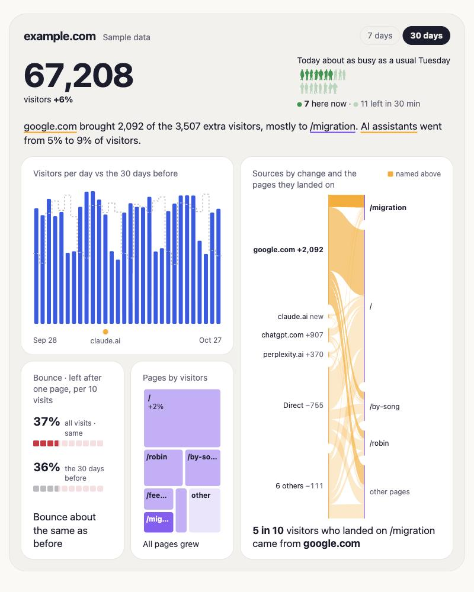

# Lede

Your site's stats, told as a story.

It runs free on Cloudflare up to about 50,000 page views a day, puts no cookies on your visitors (so no cookie banner), and your stats stay yours. Lede counts people, not bots, and says exactly what it leaves out.

## Install

1. Pick a password for your dashboard.
2. Make a Cloudflare token so Lede can read your stats. The form links to it, ready to go.
3. Open your dashboard, sign in with your password, type your site's address, and paste the line it gives you into every page of your site. The first visits show up within a couple of minutes.

[How it works, and what it counts](docs/how-it-works.md)
